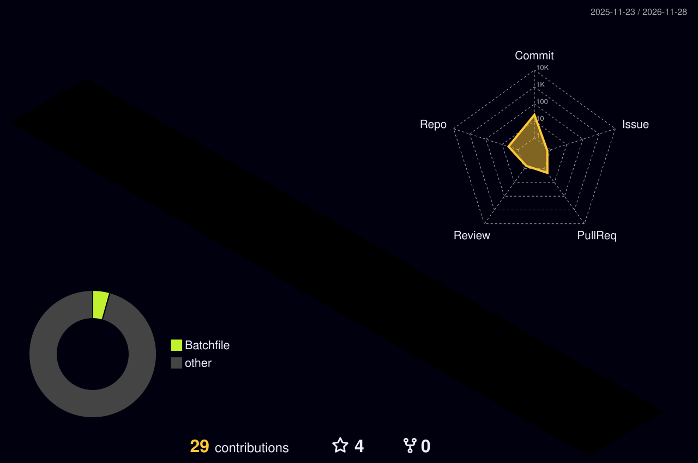

<div align="center">


<a href="https://git.io/typing-svg">
  
</a>

<br/><br/>


</div>


## 💻 whoami

```bash
$ whoami
jasmeet-singh

$ cat about.txt
CSE student at Chandigarh University who loves turning ideas into
interactive web experiences, from clean React UIs to 3D scenes.

$ ls skills/
react/  threejs/  javascript/  java/  python/  c-cpp/  mysql/  security/

$ echo $MOTTO
Dream Big. Build Bigger. Keep Growing. 🚀
```


## 🧑‍🚀 About Me

<table>
<tr>
<td width="58%" valign="top">

```js
const jasmeet = {
  name: "Jasmeet Singh",
  role: "CSE Student & Developer",
  university: "Chandigarh University",
  building: "3D Portfolio (React + Three.js)",
  learning: ["Advanced React", "Three.js", "DSA"],
  interests: ["3D Web", "Networking", "Security"],
  motto: "Dream Big. Build Bigger. Keep Growing.",
  funFact: "I turn coffee into code ☕",
};
```

</td>
<td width="42%" valign="top">

### ⚡ Quick Facts

- 🔭 Building a **3D portfolio**
- 🌱 Learning **React, Three.js, DSA**
- 🔐 Exploring **WPA2 vs WPA3**
- 🏨 Built **Hostel Management**
- 🎯 Aiming for **Full Stack roles**
- 📫 **jasmeetsingh1514@gmail.com**

</td>
</tr>
</table>


## 🛠️ Tech Arsenal

<div align="center">


<br/><br/>


</div>


## 🎯 Currently Leveling Up

<div align="center">

| Skill | Progress |
| :---- | :------- |
| ⚛️ **React** |  |
| 🧊 **Three.js** |  |
| 🧠 **DSA** |  |
| 🔐 **Cyber Security** |  |

</div>

## ✅ Goals

- [x] Build my first GitHub profile README
- [x] Set up a 3D contribution skyline and snake animation
- [ ] Finish and publish my **3D portfolio** 🧊
- [ ] Solve 200+ DSA problems 🧠
- [ ] Build a full stack project with login and database 🗄️
- [ ] Contribute to an open source project 🌍


## 🧊 3D Contribution Skyline

<div align="center">

<picture>
  <source media="(prefers-color-scheme: dark)" srcset="https://raw.githubusercontent.com/Jasmeet-07/Jasmeet-07/main/profile-3d-contrib/profile-night-rainbow.svg" />
  <source media="(prefers-color-scheme: light)" srcset="https://raw.githubusercontent.com/Jasmeet-07/Jasmeet-07/main/profile-3d-contrib/profile-green-animate.svg" />
  
</picture>

</div>

## 🐍 Snake Eating My Contributions

<div align="center">

<picture>
  <source media="(prefers-color-scheme: dark)" srcset="https://raw.githubusercontent.com/Jasmeet-07/Jasmeet-07/output/github-snake-dark.svg" />
  <source media="(prefers-color-scheme: light)" srcset="https://raw.githubusercontent.com/Jasmeet-07/Jasmeet-07/output/github-snake.svg" />
  
</picture>

</div>


## 🚀 Featured Projects

<div align="center">

<a href="https://github.com/Jasmeet-07/Hostel-Management">
  
</a>
<a href="https://github.com/Jasmeet-07/WPA2-vs-WPA3-repo-starter">
  
</a>

<a href="https://github.com/Jasmeet-07/GitHub-page">
  
</a>

<br/>

### 🧊 3D Portfolio &nbsp;

*Interactive 3D portfolio built with React, Three.js and Tailwind CSS.*

</div>


## 📊 GitHub Stats

<div align="center">


<br/>


</div>

## 📈 Activity Graph

<div align="center">


</div>


## 🤝 Open To

<div align="center">

| 🧑‍💻 Collaboration | 🎓 Internships | 🌍 Open Source | 💬 Tech Talks |
| :---: | :---: | :---: | :---: |
| Web & 3D projects | Frontend / Full Stack | Beginner friendly repos | React, Three.js, Security |

</div>

<details>
<summary><b>💡 Fun facts about me (click to open)</b></summary>

<br/>

- ☕ Coffee is my debugging partner
- 🧊 I love making websites feel alive with 3D
- 🔐 I get curious about how Wi-Fi security actually works
- 🎮 I enjoy building things more than reading about them

</details>


## 🌐 Let's Connect

<div align="center">

<a href="mailto:jasmeetsingh1514@gmail.com" title="Gmail">
  
</a>
&nbsp;&nbsp;&nbsp;
<a href="https://github.com/Jasmeet-07" title="GitHub">
  
</a>
&nbsp;&nbsp;&nbsp;
<a href="https://www.linkedin.com/in/jasmeet-singh-142748326" title="LinkedIn">
  
</a>
&nbsp;&nbsp;&nbsp;
<a href="https://www.instagram.com/jasmeet.__01/" title="Instagram">
  
</a>

<br/><br/>

**Gmail** &nbsp;·&nbsp; **GitHub** &nbsp;·&nbsp; **LinkedIn** &nbsp;·&nbsp; **Instagram**

<br/>

### 💭 "Dream Big. Build Bigger. Keep Growing."

**Thanks for visiting my profile! ⭐**

*If you liked it, drop a follow or a star on my repos.*


</div>
